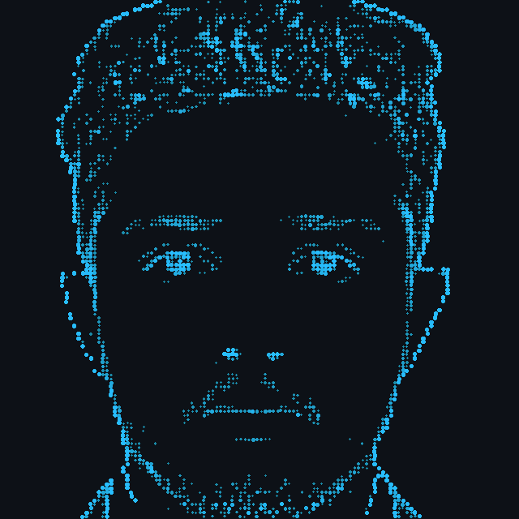

<h1 align="center">Diloosha Rajapaksha</h1>

<b>Computer Science Undergraduate at SLIIT</b>

  

  
  
  

---

### 👋 About me

I'm a Computer Science undergraduate with a strong passion for solving real-world problems through technology. I enjoy exploring areas like software development, AI, and algorithms, and I'm constantly learning new tools and technologies to grow my skills. I thrive in environments that challenge me to think critically, collaborate with others, and turn ideas into working solutions.

I'm currently looking for opportunities to learn, collaborate, and contribute. Always open to connecting. Feel free to reach out!

**Interested in:**
- AI & Machine Learning
- Full-stack development
- Embedded systems
- Backend development
- Mobile app development

**Currently working on:**
- an AI system that reads my lecture slides so I can ask it questions before exams

---

### 🛠️ Things I've made

<table>
  <tr>
    <td width="33%" valign="top">
      <h4>🏨 Hotel System</h4>
      A full-stack hotel and restaurant management system built for a real client. Getting it deployed and ready for handover taught me as much as writing the code did.
        
      
      
      
      
    </td>
    <td width="33%" valign="top">
      <h4>🎁 Pearl Gifts</h4>
      A website for a gift shop. I kept it simple on purpose: no logins or card payments, people just pick what they like and order through WhatsApp. The owner can change product photos from an admin page.
        
      
      
      
    </td>
    <td width="33%" valign="top">
      <h4>🧩 TaskLang++</h4>
      My own little programming language for scheduling tasks, built with Flex and Bison. The hardest part was catching tasks that depend on each other in a loop. I had a bug there that took me a while to find.
        
      
      
      
    </td>
  </tr>
</table>

<a href="https://github.com/DilooshaRajapaksha?tab=repositories">See everything else →</a>

---

### 🧰 What I use

   
   
  

---

### 📊 My GitHub activity

  

  

  <picture>
    <source media="(prefers-color-scheme: dark)" srcset="https://raw.githubusercontent.com/DilooshaRajapaksha/DilooshaRajapaksha/output/github-snake-dark.svg" />
    
  </picture>

---

### 📫 Say hi

I'm looking for an internship, and I'm always happy to team up on something interesting.

  
  

